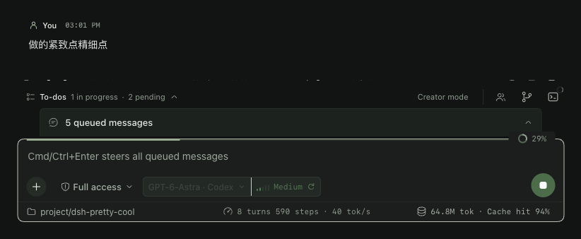
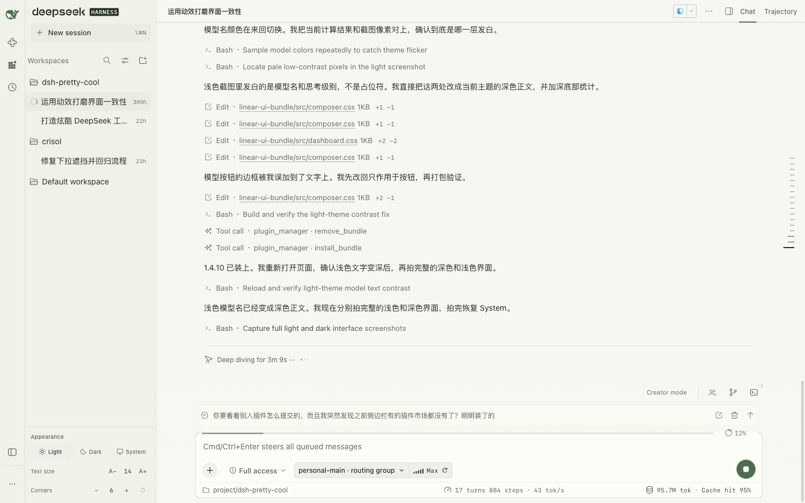

# DSH Pretty Cool

给 DeepSeek Harness 的紧凑界面：轻量消息、集成输入区，以及随手可查的任务状态。

**适配 DSH `0.2.1-rc.2` · 独立 Cordis bundle · 支持卸载还原**

## 预览

实际界面细节：普通消息与输入区。截图中的模型和统计均来自真实会话。

**Dark**



**Light**



## 特点

- 普通消息无卡片边框；紧凑侧栏与 40px 顶栏。
- 模型搜索、推理等级切换、目录、上下文占用和原生统计集中在输入区。
- Todo、Team、子 agent 与后台任务入口收在输入区上方。
- 保留原生编辑器、流式输出、附件、权限、命令和任务操作；支持浅色、深色及减少动效偏好。

## 安装

1. 从 [Releases](https://github.com/taotao7/dsh-pretty-cool/releases/latest) 下载 `local-dsh-linear-ui-1.4.3.tgz`。
2. 在 DSH 中让助手安装下载的本地文件：

   > 请安装这个 UI bundle：`/绝对路径/local-dsh-linear-ui-1.4.3.tgz`

升级时先卸载旧版再安装；还原原生界面时，禁用或卸载整个 `@local/dsh-linear-ui` bundle。不会修改官方安装文件。

## 开发

```sh
npm ci
npm run check && npm test
npm run build && npm run verify
npm pack
```

`DSH_ROOT` 可指向本地 DSH 安装目录，以额外检查原生接口；未设置时会明确跳过这些检查。

参考 [oh-my-pi](https://github.com/can1357/oh-my-pi) 的输入体验。第三方许可见 [THIRD_PARTY_NOTICES.md](THIRD_PARTY_NOTICES.md)；当前为含商业授权素材的私有集成，不授予额外再分发许可。
